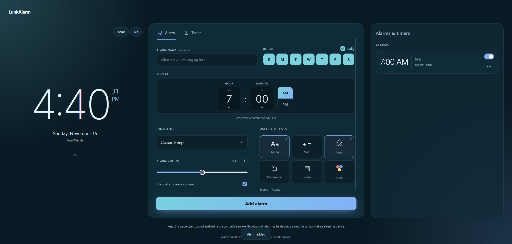
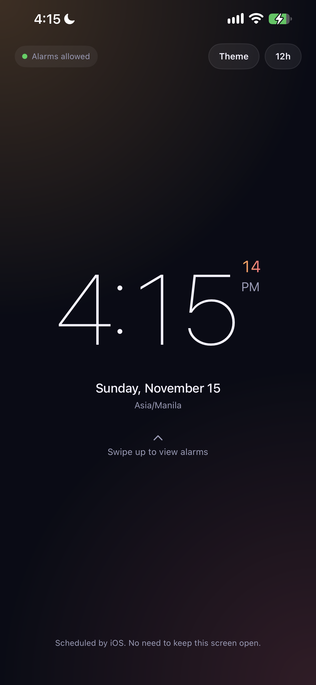
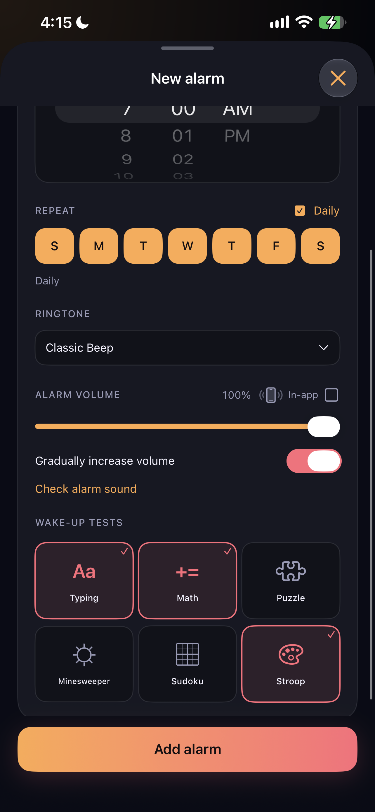
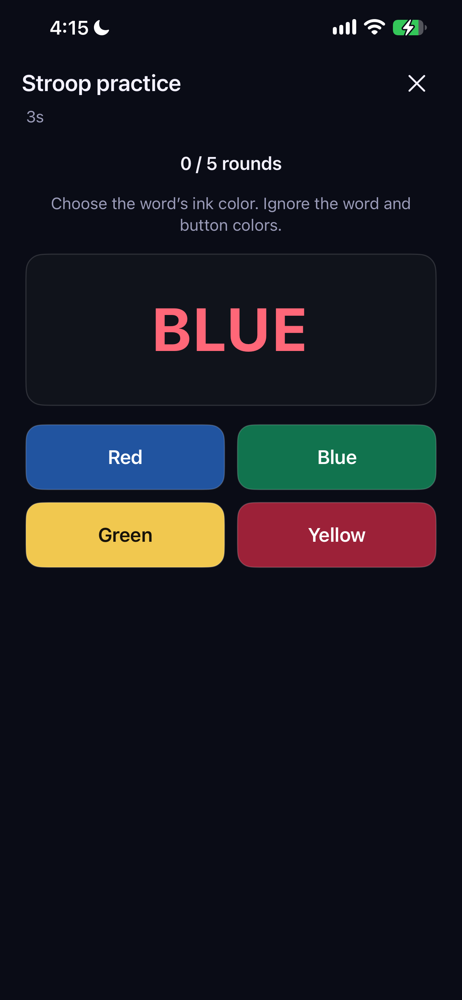
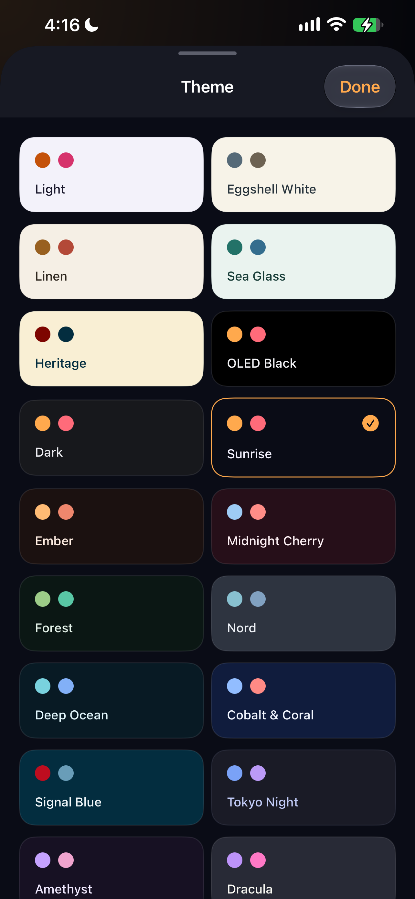

# LunkAlarm

An alarm clock for the **web**, **Android**, and **iOS**, with a large clock, custom themes, ringtones, and optional wake-up tests.

**[Open the website](https://alarm.reeeserve.online)** · **[Download the apps](https://github.com/TristanSibug/LunkAlarm/releases)**

  

<em>Website · Desktop workspace</em>

  
  
  

<em>iOS · Clock, alarm setup, and Stroop practice</em>

More screenshots · iOS themes

  

## Features

Available on the website and both mobile apps:

- Large clock with date, time zone, and 12/24-hour display.
- Named or unnamed alarms with daily or selected-weekday repeats, plus temporary countdown timers.
- Edit, duplicate, enable, disable, and delete saved alarms. Completed timers disappear automatically.
- Eighteen themes, bundled ringtones, imported audio, sound previews, and adjustable volume with optional gradual fade-in.

Your alarms and preferences stay on the current device or browser. No account is required, and data does not sync between platforms.

## Wake-up tests

Combine any of the six tests below. Configure each test’s difficulty or length and time limit, then use **Try** to practice before enabling it.

| Test | Challenge |
| --- | --- |
| Typing | Enter a case-sensitive code. |
| Math | Solve addition, subtraction, multiplication, and division problems. |
| Puzzle | Fit randomized jigsaw pieces together. |
| Minesweeper | Reveal safe squares and flag the mines. |
| Sudoku | Complete a 4×4 or 6×6 grid. |
| Stroop | Identify the word’s ink color while ignoring its meaning and the colored buttons. Choices shuffle after each correct answer. |

Selected tests run in sequence. Running out of time restarts the sequence and restores alarm sound.

## Get started

| Platform | Requirements | Open or download |
| --- | --- | --- |
| Website | A modern browser | [alarm.reeeserve.online](https://alarm.reeeserve.online) |
| Android | Android 8.0 or later | [APK releases](https://github.com/TristanSibug/LunkAlarm/releases) |
| iOS | iOS 26 or later | [IPA releases](https://github.com/TristanSibug/LunkAlarm/releases) |

**Website:** Keep the page open, sound enabled, and the device awake. Browsers can delay background tabs and cannot wake a sleeping device.

**Android:** Install the APK and grant the requested alarm permissions. Updates from the permanently signed 1.3.1 baseline retain app data without uninstalling.

**iOS:** The provided IPA is unsigned and requires signing/provisioning through a compatible sideloading tool. See the [iOS installation guide](ios/README.md).

The native apps schedule alarms through Android’s AlarmManager and Apple’s AlarmKit, so scheduled alarms do not depend on leaving the clock screen open. Permissions, device volume, and system restrictions still apply; test a short alarm with the phone locked after setup.

## Development

| Source | Implementation | Guide |
| --- | --- | --- |
| [`web/`](web/) | Standalone HTML, CSS, and JavaScript | [Website deployment](docs/WEBSITE-DEPLOYMENT.md) |
| [`android/`](android/) | Kotlin and Jetpack Compose | [Android setup and builds](android/README.md) |
| [`ios/`](ios/) | SwiftUI and AlarmKit | [iOS setup and builds](ios/README.md) |

[GitHub Actions](https://github.com/TristanSibug/LunkAlarm/actions) provides build artifacts and automated checks. GitHub Releases are uploaded manually. The earlier C# / WPF Windows implementation remains in [`src/`](src/).

MIT license.
